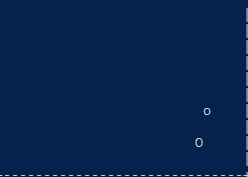

#  Лабораторная работа «Пузырьки вверх»

Консольная анимация пузырьков, написанная на языке Python. Пузырьки поднимаются снизу вверх, имеют индивидуальную скорость движения и совершают горизонтальные колебания.

---

##  Демонстрация работы программы



---

##  Описание задачи

Цель лабораторной работы — разработать консольную программу, которая имитирует движение пузырьков снизу вверх.

Каждый пузырёк обладает собственной скоростью и небольшим горизонтальным покачиванием. При достижении верхней границы игрового поля пузырёк исчезает и появляется внизу в случайной колонке.

Также реализовано управление анимацией с помощью клавиатуры.

##  Используемые технологии

- **Язык программирования:** Python 3.13
- **Операционная система:** Windows
- **Среда выполнения:** Windows PowerShell

### Используемые модули Python

| Модуль | Назначение |
|---|---|
| `time` | Управление временными интервалами анимации |
| `random` | Генерация случайных параметров пузырьков |
| `msvcrt` | Обработка нажатий клавиш |
| `os` | Настройка работы терминала |

Сторонние библиотеки не используются.

##  Возможности программы

- Отображение пузырьков в консольном игровом поле.
- Движение пузырьков снизу вверх.
- Индивидуальная скорость движения каждого пузырька.
- Горизонтальное покачивание.
- Случайное появление пузырьков в нижней части поля.
- Ограничение минимальной и максимальной скорости.
- Приостановка и возобновление анимации.
- Изменение скорости движения.
- Добавление новых пузырьков во время работы программы.
- Завершение программы с помощью клавиатуры.

##  Управление

| Клавиша | Действие |
|---|---|
| `Space` | Пауза / продолжение |
| `+` | Увеличение скорости |
| `-` | Уменьшение скорости |
| `b` | Добавление нового пузырька |
| `q` | Выход из программы |

##  Запуск программы

### Требования

- Windows 10 или Windows 11.
- Установленный Python 3.

### Инструкция

1. Склонируйте репозиторий:

   ```bash
   git clone https://github.com/OlegTimofeevMKN/bubbles-up.git
   ```

2. Перейдите в папку проекта:

   ```bash
   cd bubbles-up
   ```

3. Запустите программу:

   ```bash
   py main.py
   ```

Установка дополнительных библиотек не требуется.

##  Лицензия

Проект распространяется под лицензией MIT.

---

*Учебный проект, выполненный в рамках лабораторной работы «Пузырьки вверх».*
